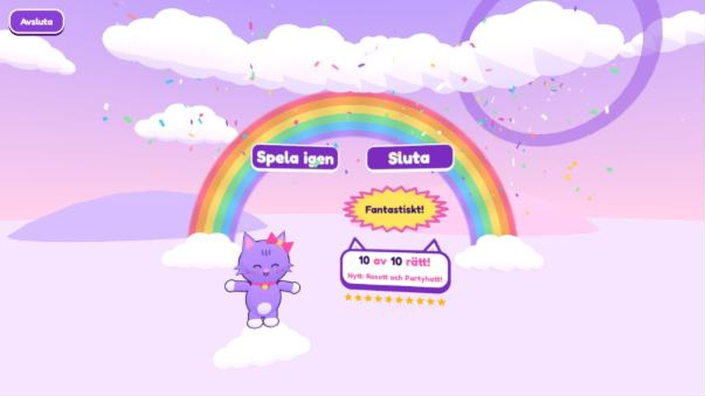

# Kattmatte

A small learning game in Swedish for children, with a cartoon pet, balloons, and a room where coins from playing buy colours and hats, and goals unlock new animals.
It runs in the browser: on a phone, tablet or computer, and in VR or passthrough on a Meta Quest 3.

**Play:** https://albertoferreirademelo.github.io/VR-cat-matte-och-bokst-ver/



## The two games

- **Matte:** a sum is shown and the balloons carry answers. Pop the right one before it drifts down.
  Levels go from "plus 1 och 2" and "tiokompisar" to the multiplication tables.
  The balloons speed up or slow down to suit the player, and facts that were missed come back more often.
- **Bokstäver:** a voice says a letter and the balloons carry letters. There is no time limit,
  and tapping the sign says the letter again. Start with both forms together ("Mm").
  Once every letter in a group reaches two learning steps, uppercase and lowercase
  practice open for that group. Each form has its own progress; opened choices stay open.

Each player has a profile with their own pet, stars, coins and progress.
Every round pays a coin per right answer (and 5 more for all right), to spend in **Mitt rum**. Progress is saved in the browser of the device that plays.
After picking a player, one tap plays their usual game (the one they played last) at the
level the game suggests: where they left off, or the next level once that one has three stars.
The other subject and the room are right beside it; "Byt nivå" opens the level path for choosing
yourself. In a headset, playing goes straight into VR. Grown-up things (deleting a player,
playing on the screen instead of in VR) are behind the ⚙️, which opens when held down.

## Run it yourself

Needs [Node.js](https://nodejs.org/).

```bash
npm install
npm run dev
```

Then open http://localhost:5173. To try it on a headset in the same Wi-Fi, run `npm run dev:quest`
and open `https://<your-pc-address>:5173` in the headset's browser (it will warn about the self-made certificate).

`npm run build` puts the finished site in `dist/`. Pushing to `main` publishes it through GitHub Pages.

`npm test` checks profile migration, switching subjects, letter-form progression and wardrobe unlocks.
With the dev server running, `/tests/browser.html` provides an isolated older-profile
fixture for checking unlocked letter forms and the upgrade of an old saved cat. It uses an in-memory store and does not
read or change real player profiles.
Adding `?xr` simulates a browser with WebXR whose initial support probe failed;
the VR button reports its selected subject and mode without entering immersive VR.
The normal game keeps a VR start option when WebXR is available, even if the
initial support probe fails. A direct tap attempts ordinary VR in that case.

## Where things are

| Folder | What is in it |
|---|---|
| `src/decks/` | The games: levels, questions and wrong answers |
| `src/game/` | The 3D scene: balloons, effects, rainbow |
| `src/ui/` | The menus and the signs |
| `src/i18n/sv.js` | Every text the players see |
| `src/room/` | The pet's room: the house, the wardrobe with its open doors, and the things on its shelves |
| `src/wardrobe/` | The pets (cat, capybara), their colours and things to wear, and how they are unlocked. See its README |
| `public/audio/` | Voice clips |
| `tools/` | The script that cuts the alphabet recording into clips |

## Credits

See [CREDITS.md](CREDITS.md). The spoken letters come from a Wikimedia Commons recording by Sertion (CC BY-SA 3.0).
